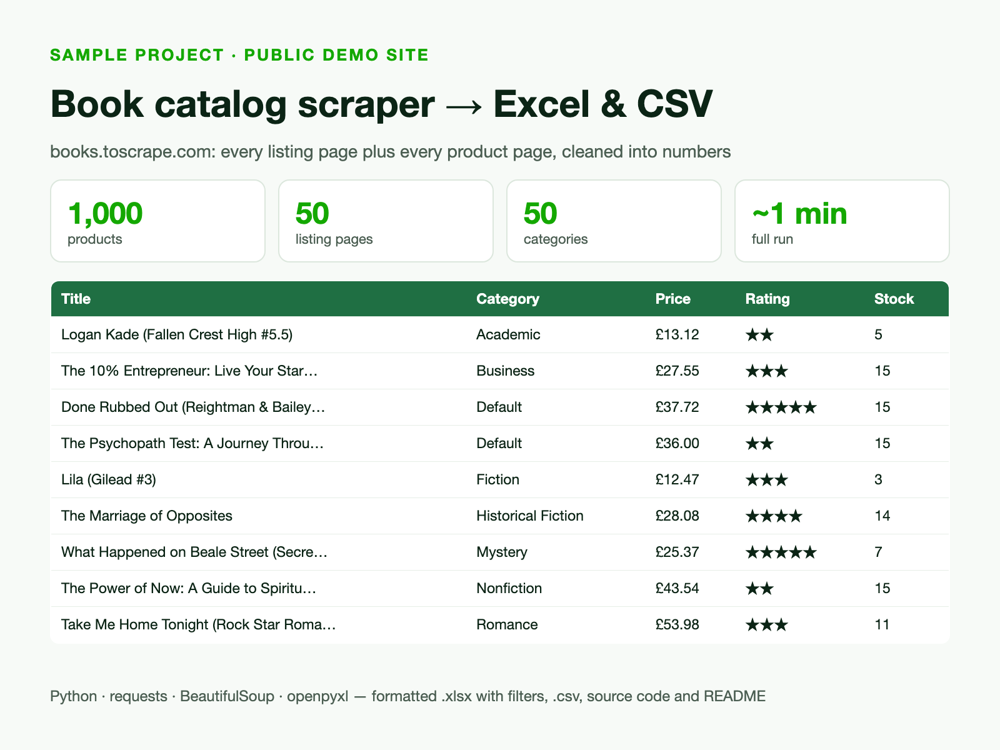

# Book catalog scraper → Excel & CSV

Demo project on [books.toscrape.com](https://books.toscrape.com), a public site made for scraping practice.



- Walks all 50 listing pages and every product page (1,000 books, 50 categories)
- Fields: title, category, price, star rating, stock count, UPC, URL
- Prices and ratings converted to numbers, rows sorted by category
- Output: formatted `books.xlsx` (frozen header, filters) and `books.csv`
- 8 parallel workers, retries on network errors; full run takes about a minute

```bash
pip install -r requirements.txt
python scrape_books.py
```

`sample_output.csv` shows the first 50 rows of a real run.
